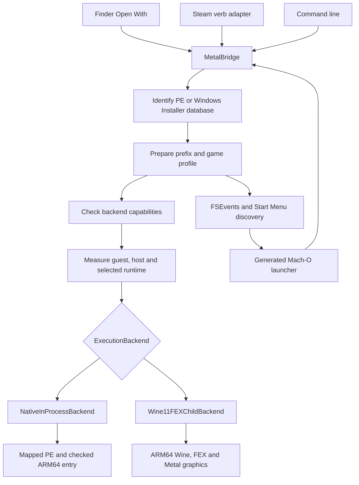

# Metal

Metal is an Apple Silicon Windows compatibility research project. Its macOS host, **MetalBridge**, offers a small in-process ARM64 PE engine and a separate ARM64 Wine 11/FEX backend for applications that need the Windows runtime. Finder, generated app bundles, the CLI, and the Steam adapter all enter the same launch path.

**Release status:** the portable loader, Swift inspector, prefix manager, profile selection, and Steam argument adapter have been exercised on Linux. The macOS host and game compatibility are awaiting Apple Silicon validation. The repository includes an ARM64 macOS build and execution smoke workflow. A passing native smoke test exercises a small PE entry point. Each game requires separate testing.

## Execution paths



| Capability | Implementation and limits |
| --- | --- |
| PE inspection | Checks PE32 and PE32+ headers, sections, RVA/file boundaries, imports by name and ordinal, exports, relocations, and icon resources. MSI recognition checks compound storage and the Installer database CLSID. |
| Native ARM64 execution | Maps headers and sections into a zero-filled Mach allocation, applies data DIR64 relocations, binds recognized imports, and seals the image read-only. A separate per-process `MAP_JIT` page executes validated scalar leaf code using per-thread write protection. The kernel chooses the image address and host page boundaries. |
| Native entry contract | Up to 256 AArch64 instructions, defined volatile scalar registers, wide immediate moves, immediate addition/subtraction, NOP, BTI c, and RET. Recognizes import thunks for process ID, tick count and thread-local last-error access. A pthread-local shadow TEB supplies process and thread IDs for admitted X18 loads. Callback-only TLS modules run checked process-attach callbacks in order before the entry point. |
| NT shims | Current-process read-only/read-write reserve-and-commit allocations and releases, unnamed events, relative waits, recursive critical sections, and basic system information. The resolver can bind these addresses. General guest call frames, exception unwinding, named NT objects, arbitrary X18 use, and static TLS templates require the Wine backend. |
| Windows applications and installers | The child launches the ARM64 slice of MetalSharp Wine 9.0 (Wine 11.22). Its Wine loader handles full PE initialization, DLL linkage, Win32, registry state, and MSI installation. FEX runs inside this child for x86 guests. The in-process engine has no embedded x86 FEXCore or FOZ cache. |
| Graphics and input | Native diagnostics query Metal families, create a Retina-aware NSWindow, present a CAMetalLayer drawable, and sample a controller. Games use the child runtime's Win32, DXGI and D3D implementation. Native guest-callable D3D11/DXGI COM and user32 window/message interfaces are open engineering work. |
| Fallback | `auto` probes before dispatch. An unsupported image selects the whole Wine backend. Explicit `native-inproc` reports the incompatibility. The host does not dynamically initialize arbitrary Wine DLLs in its own address space. |

Wine's PE DLLs depend on Wine runtime state, including its loader, thread environment, exception handling, and graphics driver. The signed ARM64 distribution supplies that state together with its Darwin FEX port and Mullion, its DXMT-derived graphics implementation. The D3DMetal build from the same distributor uses an x86_64 host. [Runtime release](https://github.com/metalsharp/MetalSharp-Wine/releases/tag/v9.0) · [Runtime features](https://github.com/metalsharp/MetalSharp-Wine/blob/v9.0/docs/FEATURES.md) · [DXMT runtime dependencies](https://github.com/3Shain/dxmt/wiki/Device-System-Runtime-Specifications)

## Build and run

Use an Apple Silicon Mac, macOS 14 or later, the Xcode command line tools with Swift 5.10 or later, and Python 3.8 or later. The child runtime requires macOS 15 or later. Its signed 32-bit x86 execution path requires macOS 26.4 or later. Metal 4 capability reporting requires building with the macOS 26 SDK or newer. [Runtime system requirements](https://github.com/metalsharp/MetalSharp-Wine/tree/v9.0)

```sh
cd MetalBridge
swift build -c release
python3 -m unittest discover -s Tests -v
sh scripts/test_shared.sh
sh scripts/package_app.sh
host="$HOME/Applications/MetalBridge.app/Contents/MacOS/MetalBridge"
"$host" doctor
```

The packaging script builds ARM64 binaries, signs the launcher and host, verifies the result, and registers it with LaunchServices. The default identity is ad hoc for local development. Set `SIGN_IDENTITY` to a Developer ID Application signing identity for a distribution build. Public distribution also requires the distributor's own notarization. The host uses the JIT entitlement. Its executable memory path uses per-thread write protection.

```sh
app="$HOME/Applications/MetalBridge.app"
codesign --verify --strict --deep "$app"
codesign -d --entitlements :- "$app"
"/System/Library/Frameworks/CoreServices.framework/Frameworks/LaunchServices.framework/Support/lsregister" -f "$app"
python3 Tests/fixtures.py /tmp/metal-answer.exe
"$host" inspect /tmp/metal-answer.exe
rc=0
"$host" run --backend native-inproc /tmp/metal-answer.exe || rc=$?
test "$rc" -eq 42
"$host" doctor --present
```

The presentation check opens a blue window for two seconds. Its red component responds to a connected controller's left stick. To repeat the host signing step manually after a local rebuild, sign the nested helper first.

```sh
codesign --force --options runtime --sign - "$app/Contents/MacOS/MetalAppLauncher"
codesign --force --options runtime --entitlements MetalBridge.entitlements --sign - "$app"
```

## Install the compatibility runtime

```sh
sh scripts/bootstrap_runtime.sh
"$host" run --backend wine11-fex "$HOME/Downloads/setup.exe"
"$host" run "$HOME/Downloads/setup.msi"
```

Bootstrap downloads the pinned **1.39 GB** ARM64 release archive, verifies SHA-256, checks the macOS code signature, asks Gatekeeper to assess the bundle, checks both Mach-O executables, and indexes runtime components. It installs under `~/.local/share/MetalBridge/runtime/`. Pass a local copy of `MetalSharp-Wine-9.0-arm64.zip` as its only argument for an offline archive. The expected digest is `2522e4f6f3cb79f79a486041301d790a2c714d084e7f328e57736f464a12a254`. [Release asset metadata](https://api.github.com/repos/metalsharp/MetalSharp-Wine/releases/tags/v9.0)

Before x86 dispatch, the host validates the architecture and required Wine CPU-module exports of the selected FEX DLL. Both the ARM64EC and WoW64 checks have been exercised against the published v9.0 DLLs.

The runtime keeps its own signatures and third-party licenses. This repository's MIT license covers MetalBridge source. Redistributors must review the runtime's component terms. [Runtime license inventory](https://github.com/metalsharp/MetalSharp-Wine/blob/v9.0/docs/LICENSES.md)

## Finder and installed applications

Select a Windows executable in Finder, use **Get Info → Open with → Metal → Change All**, and repeat for MSI packages if desired. Registration makes Metal an eligible viewer. Finder retains the user's choice of default application. For a one-time open, use `open -a "$app" "$HOME/Downloads/setup.exe"`.

Each launch watches its prefix's C: drive. The watcher scans Program Files, Program Files (x86), and the ProgramData Start Menu. Local C: targets in shortcuts take priority. When a shortcut is absent, the scanner chooses the shallowest eligible executable under each installation directory and skips common uninstallers and redistributables. Use `bundle` to choose another executable explicitly.

```sh
"$host" watch 3061570
# In another terminal, create a wrapper immediately for the smoke fixture.
"$host" bundle /tmp/metal-answer.exe
```

Bundles appear under `~/Applications/MetalBridge Apps/`. Each contains an ad-hoc signed Mach-O launcher and the absolute paths of its host and guest. Available embedded icons are ranked by dimensions and color depth and converted to ICNS. Keep the host and target at those paths. The standalone `watch` command continues until interrupted. Launch-triggered watchers end after the launched process exits.

## Steam adapter

```sh
tool="$HOME/Library/Application Support/Steam/compatibilitytools.d/MetalBridge"
mkdir -p "$tool"
install -m 644 Resources/steam/compatibilitytool.vdf Resources/steam/toolmanifest.vdf "$tool/"
install -m 755 Resources/steam/proton_entry.py "$tool/"
rc=0
SteamAppId=271590 "$tool/proton_entry.py" run /tmp/metal-answer.exe || rc=$?
test "$rc" -eq 42
readlink "$HOME/.local/share/MetalBridge/prefixes/271590/dosdevices/z:"
```

The adapter forwards arguments and the guest exit status. For `waitforexitandrun`, the child backend first invokes the prefix's `wineserver -w`. Set `METALBRIDGE_BACKEND=wine11-fex` to force the child backend. A real Windows game can also be invoked directly with `"$host" run --app-id 3061570 -- "/path/to/game.exe"`.

Restart Steam and check **Properties → Compatibility** for **Metal (Apple Silicon)** if that client exposes the selector. Valve documents local Proton discovery on Linux. The manifest alone cannot activate Steam Play on a stock macOS client that leaves it disabled. The direct adapter command above tests the actual launcher independently of client discovery. Windows depot installation, Steam DRM, online services, and publisher anti-cheat support are unverified. [Valve's compatibility-tool documentation](https://github.com/ValveSoftware/Proton#install-proton-locally) · [macOS client integration experience](https://github.com/NotProtonNot/NotProton)

| Matching game | Profile supplied to the backend |
| --- | --- |
| GTA V, IDs 271590 and 3240220 | `-nobattleye` for the story-mode configuration, `d3dcompiler_47=n,b`, `DXMT_METALFX_SPATIAL=1` |
| Persona 5: The Phantom X, ID 3061570 | `WINE_LARGE_ADDRESS_AWARE=1`, `d3d11,dxgi,winhttp,wininet=n,b` |
| ZenlessZoneZero.exe, GenshinImpact.exe, YuanShen.exe | `WINEMSYNC=1`, Wine builtin `crypt32=b` and `winhttp=n,b`. The pinned Wine version includes the authenticated-attribute ordering fix released in 11.21. [Wine release notes](https://list.winehq.org/hyperkitty/list/wine-releases%40list.winehq.org/thread/RCRSGXTP7DN32FFOBEHTXMJEFCMMPTZX/) |

The shared prefix manager maps C: to `drive_c` and Z: to the user's home. Numeric AppIDs use separate prefix directories. Finder uses `default` for unassigned files. Prefixes isolate registry and install state. Windows programs run with the current user's filesystem permissions. `METALBRIDGE_GRAPHICS=dxmt` selects the pinned runtime's default Mullion path. A request for `d3dmetal` produces a diagnostic on this ARM64/FEX build.

## AttestBridge evidence

Before dispatch, the host hashes the target and readable file-backed host images with SHA-256. For Wine launches it also hashes both executables and the inventory of selected FEX, NT, crypto, networking, and graphics runtime files. Each item records its origin. Shared-cache images without readable files have no file digest. The report covers prelaunch files. A child can load more code later, and on-disk files can change between measurement and use.

Reports bind the OS version, selected backend, observed `csrutil status` output, launcher signature check, file inventory, and challenge. AMFI observation records explicitly permissive boot arguments when visible and reports unknown otherwise. On Secure Enclave-equipped systems a local P-256 key signs the exact JSON payload. The wrapped key and public key live in `~/.local/share/MetalBridge/identity/`. Without an available enclave the default output is a measurement-only report. Set `METALBRIDGE_REQUIRE_QUOTE=1` to require a signature. Each prefix atomically publishes its most recent record at `last-prelaunch.json`.

```sh
# For a local round trip. A remote verifier supplies its own fresh challenge.
challenge=$(openssl rand -base64 32)
rc=0
METALBRIDGE_CHALLENGE="$challenge" METALBRIDGE_REQUIRE_QUOTE=1 \
  "$host" run /tmp/metal-answer.exe || rc=$?
test "$rc" -eq 42
store="$HOME/.local/share/MetalBridge"
"$host" verify "$challenge" "$store/identity/public.x963" \
    "$store/prefixes/default/last-prelaunch.json"
```

A relying party must enroll and pin the public key independently, consume each challenge once, and apply its own measurement policy. A local key signature authenticates the report to that key. Apple-backed enrollment uses a separate protocol.

**App Attest on macOS 27+.** Build with a toolchain exposing native Mac DeviceCheck (Swift 6.4+ in this package). Configure an App Attest-capable App ID, matching bundle identifier, provisioning profile, signing identity, and environment. `Resources/AppAttest.entitlements` provides the development entitlement set. From the provisioned app, `app-attest-enroll NONCE_BASE64 NEW_ENROLLMENT_JSON` produces an Apple enrollment object and key ID. Use a server-issued challenge, validate enrollment on the server, and retain the key ID. Supply `METALBRIDGE_APP_ATTEST_KEY_ID` and `METALBRIDGE_CHALLENGE` for subsequent launches in a supported application context. Assertions cover SHA-256 of the exact payload bytes. Unsupported contexts report an error.

The relying party verifies Apple's chain, RP ID, key ID, challenge, macOS key access control property, and assertion counter according to Apple's protocol. The local `verify` command checks the independently pinned P-256 quote format. Server-side Apple enrollment and anti-cheat vendor integration are outside this implementation. [Apple's macOS App Attest overview](https://developer.apple.com/videos/play/wwdc2026/201/) · [Server verification procedure](https://developer.apple.com/documentation/devicecheck/validating-apps-that-connect-to-your-server)
